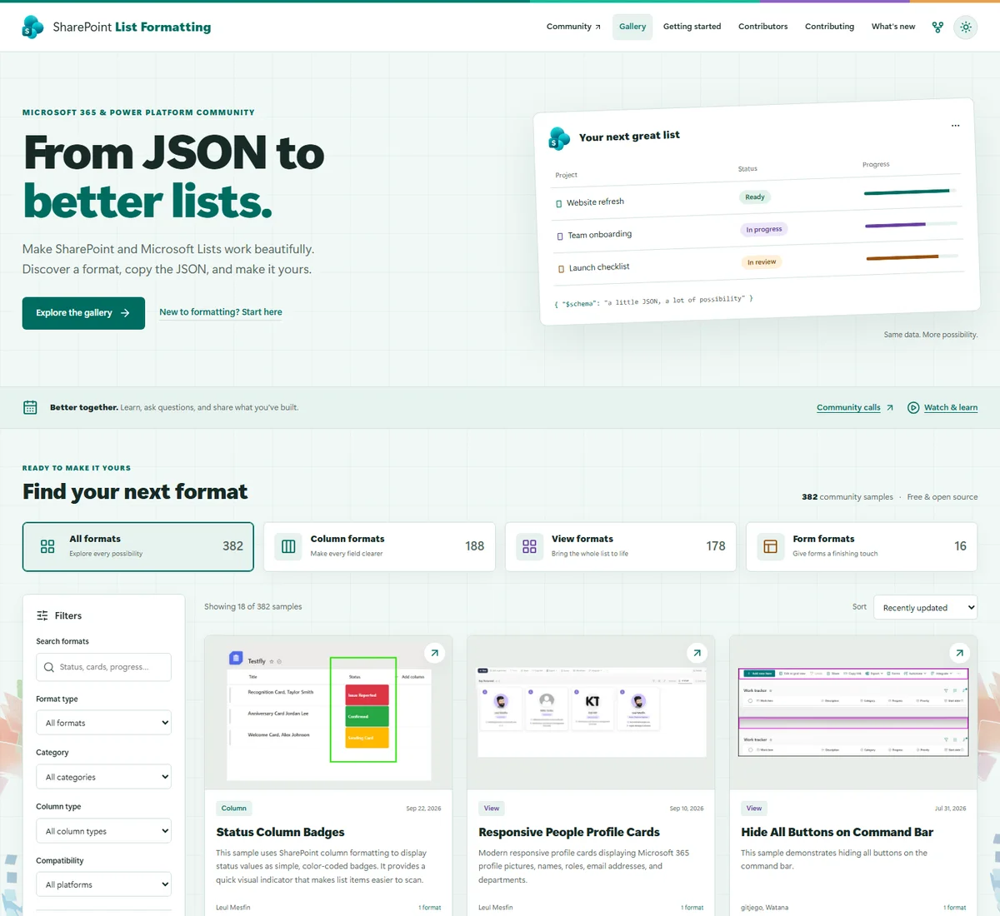

# SharePoint List Formatting Samples

**[Explore the List Formatting gallery](https://pnp.github.io/List-Formatting/)**

Make SharePoint and Microsoft Lists work beautifully with community-built,
copy-ready JSON formats. Customize individual columns, transform list and
library views, or give forms a more useful layout.

Find a format, check its requirements, copy the JSON, and make it yours.
You do not need to clone the repository to use a sample.

> [!NOTE]
> The preview shows the updated gallery design currently under review.
> The public gallery will be updated after that review is complete.

> [!IMPORTANT]
> This is a community effort maintained with the
> [Microsoft 365 & Power Platform Community](https://aka.ms/community/home).
> Samples are provided as-is, are not officially supported Microsoft products,
> and do not include a service-level agreement. Check prerequisites and test
> every format in your own environment before using it in production.

## Find and apply a format

1. **Explore:** browse the [gallery](https://pnp.github.io/List-Formatting/) or
   the source folders below.
2. **Check the requirements:** review the sample's README, column types and
   internal names, view settings, platform compatibility, and permissions.
3. **Choose a definition:** some samples provide multiple styles or separate
   form Header, Body, and Footer files. Select the variant you actually need.
4. **Copy the complete JSON:** use **Copy JSON** or **Download JSON** in the
   updated gallery, or copy the definition directly from GitHub.
5. **Apply and adapt:** use the appropriate formatting panel, replace any
   tenant-specific values, preview the result, and save. Keep a copy of your
   previous format so you can restore it.

| Format | Source | Where to apply it |
| --- | --- | --- |
| Column | [Column samples](./column-samples/) | **Format this column** > **Advanced mode**; see [applying column formats](./docs/gettingstarted/columnformats.md) |
| View | [View samples](./view-samples/) | **Format current view**; see [applying view formats](./docs/gettingstarted/viewformats.md) |
| Form | [Form samples](./form-samples/) | **Edit form** > **Configure layout** > the matching Header, Body, or Footer; see [applying form formats](./docs/gettingstarted/form-formatting.md) |

Formats differ in their requirements and supported SharePoint versions. Some
actions update data, delete items, or run flows. Understand those actions before
using them. Formatting is **not a security control**: hiding a value visually
does not remove access to the underlying data.

Browsing the gallery is free. Individual samples may require licenses,
permissions, flows, API keys, or third-party services of their own; check the
sample's requirements before use.

## Discover more in the gallery

The updated gallery provides:

- Screenshot-first browsing with search, sample-type filters, categories,
  compatibility, contributors, and advanced formatting filters.
- A page for each sample with setup guidance, source links, full definitions,
  variant selection, and complete copy/download actions.
- Getting-started guides, a formatting reference, and editing/deployment tools.
- Contributors with GitHub profile images and links to their shared formats.
- A **What's new** timeline based on sample creation and update metadata.
- Light and dark themes, responsive layouts, and accessible navigation.

The original sample READMEs and JSON files remain the source of truth.
Automated gallery checks do not prove that every sample works in every tenant.

## Contribute and get recognized

New samples, improvements, documentation fixes, screenshots, accessibility work,
and issue reports are welcome. First-time contributors are encouraged to join in.

1. Search the [gallery](https://pnp.github.io/List-Formatting/) and
   [existing issues](https://github.com/pnp/List-Formatting/issues) to avoid
   duplicating work.
2. Read the [Contribution Guidance](./.github/CONTRIBUTING.md) and
   [creating a sample](./docs/contributing/sample.md) guide.
3. Fork the repository, branch from `master`, and keep the pull request focused
   on one sample or one logical improvement.
4. Include the sample's README, JSON definitions, local preview image, and
   `assets/sample.json` metadata. Document each variant's requirements and
   application destination.
5. Follow the [contribution checklist](./.github/CONTRIBUTING.md), test changed
   formats in SharePoint, and describe what you tested in your pull request.

Start with the [column](./column-samples/README-template.md),
[view](./view-samples/README-template.md), or
[form](./form-samples/README-template.md) README template and the
[sample metadata template](./sample-template.json).
You can also help by [improving the documentation](./docs/contributing/docs.md)
or [contributing to tools](./docs/contributing/tools.md).

### Community Contributor badge

An approved code or documentation contribution can qualify you for the
**Community Contributor - Microsoft 365 & Power Platform Community** badge,
subject to the published criteria.

See the [Credly badge and earning criteria](https://www.credly.com/org/m365pnp/badge/community-contributor-microsoft-365-power-platform-)
and the [Community Recognition Program](https://aka.ms/community/recognition)
for registration, eligibility, and how recognition is issued. An accepted pull
request does not mean a badge is issued instantly or automatically.

### Contributor License Agreement

Most contributions require you to agree to a Contributor License Agreement
(CLA) declaring that you have the right to, and actually do, grant us the rights
to use your contribution. For details, visit https://cla.microsoft.com.

When you submit a pull request, a CLA-bot will automatically determine whether you need to provide
a CLA and decorate the PR appropriately (e.g., label, comment). Simply follow the instructions
provided by the bot. You will only need to do this once across all repos using our CLA.

## Connect with the community

Learn together, ask questions, and share what you have built:

- [Community Home](https://aka.ms/community/home) - explore community initiatives
  for Copilot, Microsoft 365, and Power Platform.
- [Community calls](https://aka.ms/community/calls) - see the schedule and download
  recurring invitations. Everyone is welcome.
- [Community YouTube channel](https://aka.ms/community/youtube) - watch tutorials,
  demos, and call recordings.
- [List Formatting video playlist](https://www.youtube.com/playlist?list=PLR9nK3mnD-OXgMjDBdjWUTRia89oixBhx)
  - go deeper into formatting-specific patterns.
- [Present a community demo](https://aka.ms/community/request/demo) - share your
  solution and help others learn.

## Documentation and tools

- [Getting started with the samples](./docs/gettingstarted/index.md)
- [Column formatting documentation](https://learn.microsoft.com/sharepoint/dev/declarative-customization/column-formatting)
- [View formatting documentation](https://learn.microsoft.com/sharepoint/dev/declarative-customization/view-formatting)
- [Configure the list form](https://learn.microsoft.com/sharepoint/dev/declarative-customization/list-form-configuration)
- [Conditionally show or hide form columns](https://learn.microsoft.com/sharepoint/dev/declarative-customization/list-form-conditional-show-hide)
- [Formatter helper tools](./docs/tools/index.md), including SP Formatter and Jsonify
- [Advanced deployment with VS Code, PowerShell, and CLI for Microsoft 365](./tools/general-dynamic-deployment-with-vscode/)

## Issues, questions, and support

For a problem with a particular sample, review its README, search
[existing issues](https://github.com/pnp/List-Formatting/issues), then use the
[repository issue forms](https://github.com/pnp/List-Formatting/issues/new/choose).
Include the sample path, reproduction steps, expected behavior, and relevant
environment details. Do not post credentials, access tokens, or private tenant data.

For general SharePoint product or tenant issues, use Microsoft documentation,
your Microsoft support channel, or the appropriate product community rather
than treating a community sample as an officially supported product.
See the [issue and support guidance](./docs/contributing/issues.md).
Community help is voluntary and provided on a best-effort basis.

## Code of Conduct

This project has adopted the [Microsoft Open Source Code of Conduct](https://opensource.microsoft.com/codeofconduct/).
For more information see the [Code of Conduct FAQ](https://opensource.microsoft.com/codeofconduct/faq/) or
contact [opencode@microsoft.com](mailto:opencode@microsoft.com) with any additional questions or comments.

## License and disclaimer

This repository is licensed under the [MIT License](./LICENSE).

**SAMPLES AND DOCUMENTATION ARE PROVIDED AS IS, WITHOUT WARRANTY OF ANY KIND,
EXPRESS OR IMPLIED, INCLUDING MERCHANTABILITY, FITNESS FOR A PARTICULAR PURPOSE,
OR NON-INFRINGEMENT.**

> Sharing is caring!
